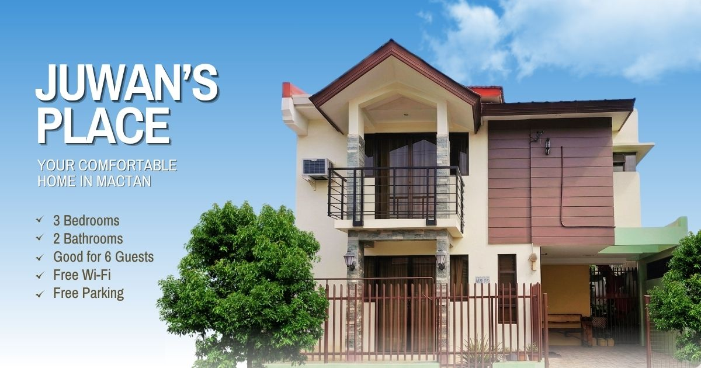

<h1 align="center">Juwan's Place</h1>

<p align="center">
  <strong>An entire three-bedroom home in Lapu-Lapu City, Cebu — and the website that tells its story.</strong>
</p>

<p align="center">
  <a href="https://juwansplace.com"><strong>Visit the site →</strong></a> ·
  <a href="https://www.airbnb.com/rooms/27705702"><strong>Book on Airbnb →</strong></a> ·
  <a href="https://maps.app.goo.gl/2exe4A7Uad8qCo5f9"><strong>Open in Maps →</strong></a>
</p>

<p align="center">
  
  
  
  
  
  
</p>

---

## The stay

Juwan's Place is a whole house, not a room in someone else's. Six guests, three
bedrooms, two bathrooms, a kitchen you can actually cook in, and a living room
worth sitting in after a day on the water. It sits in **Barangay Babag,
Lapu-Lapu City** — inside the wider Mactan airport area, on a residential
subdivision with round-the-clock security, close enough to the terminal for an
early flight and close enough to the coast for a slow one.

It suits families who want everyone under one roof, groups who would rather not
split across hotel rooms, and working travellers who need Wi-Fi, a table to work
at, and a door that closes.

> **4.75 ★ across 40 Airbnb reviews** · Hosted by Estrella Duran, a **Superhost**

### What's in the house

| | |
| --- | --- |
| 🛏️ **Three bedrooms** | The Blue, Yellow and Pink rooms — each air-conditioned, each with its own character |
| 🛁 **Two bathrooms** | Hot and cold shower, plus an upstairs bathtub |
| 🍳 **Kitchen & dining** | Refrigerator, cooking space, and a table everyone fits around |
| 📶 **Free Wi-Fi & cable TV** | Enough for a work call or a slow evening |
| 🚗 **Garage & free parking** | Off-street, at the property |
| 🏋️ **Home fitness** | Stationary bike and a multifunction gym station |
| 🛡️ **24/7 subdivision security** | A residential neighbourhood, not a busy strip |
| 🐾 **Pet-friendly** | With a few sensible conditions |
| ✈️ **Airport pickup** | May be included on qualifying longer stays, when the host confirms |
| 🚙 **Transportation** | Cebu City and province trips can be arranged, subject to availability |

### Getting around

Mactan Shrine and the Lapu-Lapu monument, the island's coastline, Cebuano food a
short drive away, and the bridges into Cebu City when you want a bigger day out.
The site's **Location** page maps all of it.

**Reservations and payments happen on Airbnb only.** This site never takes a
booking, quotes a price or collects a payment — it points at the listing, where
Airbnb's protections apply.

---

## The website

Live at **[juwansplace.com](https://juwansplace.com)**. A statically prerendered
marketing site — no database, no backend, no secrets — built to read like an
editorial magazine rather than a listing template.

### What makes it worth a look

- **A page that introduces itself.** A one-time preloader hands off to a
  three-layer colour curtain that closes over the old route and lifts off the
  new one, so navigation reads as a cut rather than a flash of white.
- **Scroll that means something.** Lenis drives smooth scrolling; GSAP
  ScrollTrigger pins sections and turns vertical scroll into horizontal travel —
  a card reel, and a stack of postcards that fans apart as you go.
- **Play in the margins.** Hand-drawn SVG strokes draw themselves in at the page
  edges, headline letters react to the cursor, and a trail of die-cut landmark
  stickers follows the pointer across the Location page.
- **It works on a phone.** Every pinned reel has a swipeable, snap-scrolling
  equivalent with prev/next controls, and the layout is checked for horizontal
  overflow at eight widths from 360px up.
- **Motion you can turn off.** `prefers-reduced-motion` is honoured everywhere —
  the preloader, the curtain, the smooth scroll, every entrance and parallax.

### Pages

| Route | What it does |
| --- | --- |
| `/` | The pitch — bedrooms, shared spaces, the area, reviews, and the map |
| `/the-house` | Rooms, amenities, services, and the 3D tour panel |
| `/location` | Lapu-Lapu and Mactan in depth, with an embedded map of the property |
| `/house-rules` | Occupancy, visitors, pets, care of the home, arrival and departure |
| `/faq` | Nine practical questions, answered plainly |
| `/privacy` · `/booking-safety` · `/accessibility` | Policy pages |

---

## Stack

- **[Next.js 16](https://nextjs.org)** App Router with Turbopack, **React 19**, **TypeScript 5.9**
- **[Tailwind CSS 4](https://tailwindcss.com)** over a hand-written design layer in `globals.css`
- **[GSAP 3](https://gsap.com)** with ScrollTrigger and SplitText for choreography
- **[Lenis](https://lenis.darkroom.engineering)** for smooth scrolling
- Self-hosted **Instrument Sans** and **Archivo Narrow** — no font CDN
- **Playwright** smoke suite across eight routes and eight viewports
- Statically prerendered, deployed on **Vercel**

### A few decisions worth knowing about

- **Breakpoint-safe motion.** All ScrollTrigger setup runs inside
  `gsap.matchMedia`, so crossing 768px tears down the branch that no longer
  applies and rebuilds the one that does — leftover inline transforms included.
- **Smooth scroll that yields.** Lenis holds the scroll position through a lerp
  and ignores foreign scroll events. The wrapper detects a genuine native scroll
  mid-animation and hands control back, which is what stopped the page twitching
  when a trackpad fling met an anchor jump.
- **No API keys in the browser.** The map is Google's keyless embed endpoint with
  an on-brand place card drawn over it, rather than the Maps Embed API and a
  billable key shipped to every visitor.
- **Photography is drop-in.** `npm run images` scans `public/images/` and writes
  a typed manifest, so adding a photo needs no code change — and designed
  placeholders stand in while a folder is empty.
- **Every environment variable is `NEXT_PUBLIC_`.** There is nothing in this
  repository that is meant to be secret.

---

## Getting started

Node.js 20.9 or newer.

```bash
git clone https://github.com/nathanaellarida/juwans-place.git
cd juwans-place
npm install
cp .env.example .env.local
npm run dev
```

Open <http://localhost:3000>.

### Environment variables

Every value has a working default, so the site runs with an empty `.env.local`.
Override them per deployment.

| Variable | Purpose |
| --- | --- |
| `NEXT_PUBLIC_SITE_URL` | Canonical origin for metadata and social cards. Defaults to the production domain; set it on previews so they describe themselves. |
| `NEXT_PUBLIC_AIRBNB_URL` | The official Airbnb listing |
| `NEXT_PUBLIC_AREA_MAP_URL` | The host's public Google Maps listing |
| `NEXT_PUBLIC_CONTACT_URL` | The approved `tel:` link |
| `NEXT_PUBLIC_MATTERPORT_URL` | Future 3D tour. Left empty, the "coming soon" panel shows instead. |

### Adding photography

Drop approved images into the category folders under `public/images/`:

```
public/images/
├── property/     bedrooms, living, kitchen, bathrooms, fitness, exterior
├── lapu-lapu/    shrine, airport, coast, city, food, monument
├── postcards/    one folder per postcard on the Location page
├── extras/       one folder per perk card
└── stickers/     cursor-trail artwork — every file joins the trail
```

```bash
npm run images
```

This regenerates `src/generated/image-manifest.ts`, and also runs automatically
before `dev` and `build`. Empty folders are intentional — the UI shows designed
placeholders until real files arrive. See
[docs/image-guide.md](docs/image-guide.md) for filenames, crop guidance,
licensing and privacy exclusions.

### Content

Durable facts live in `src/data/` — property, amenities, house rules, FAQs,
places, reviews. Integration values and navigation live in `src/config/site.ts`.
Prices, availability, cancellation terms and arrival instructions stay on Airbnb
by design.

---

## Quality checks

```bash
npm run lint       # ESLint
npm run typecheck  # tsc --noEmit
npm run build      # production build
npm run smoke      # Playwright smoke suite
```

The smoke suite starts the production server, walks all eight routes, exercises
the accessible menu, watches for browser console errors, checks for horizontal
overflow at 360, 390, 430, 768, 1024, 1280, 1440 and 1920 pixels, and writes
screenshots to `implementation-captures/`.

## Deployment

1. Import the repository into Vercel and accept the detected Next.js settings.
2. Add only the environment variables listed above.
3. Deploy, then verify the Airbnb link, the map, the `tel:` link and the 3D tour
   panel in production.
4. Add the production domain to the Airbnb listing so guests can confirm the site
   is genuinely connected to the property.

The apex domain is canonical; `www` redirects to it.

## Documentation

| | |
| --- | --- |
| [Content guide](docs/content-guide.md) | Voice, claims, and what must stay on Airbnb |
| [Image guide](docs/image-guide.md) | Folder map, filenames, crops, licensing, privacy |
| [Layout specification](docs/layout-specification.md) | Page structure and spatial rhythm |
| [Motion specification](docs/motion-specification.md) | Timings, easings, reduced-motion behaviour |
| [Responsive specification](docs/responsive-specification.md) | Breakpoints and per-width intent |
| [Implementation map](docs/implementation-map.md) | Where each piece of the design lives in code |
| [Security notes](docs/security-notes.md) | Threat surface and the booking-safety stance |

## Booking safety

Guests should book only through the Airbnb listing linked here. This site never
requests payment, card details or personal documents, and it will never ask a
guest to move a conversation off Airbnb. See
[/booking-safety](https://juwansplace.com/booking-safety).

## Ownership

All code, graphics, copy and the Juwan's Place identity in this repository are
original work. Property photography and the Juwan's Place name belong to
the property owner.

No open-source licence is granted — all rights reserved.
